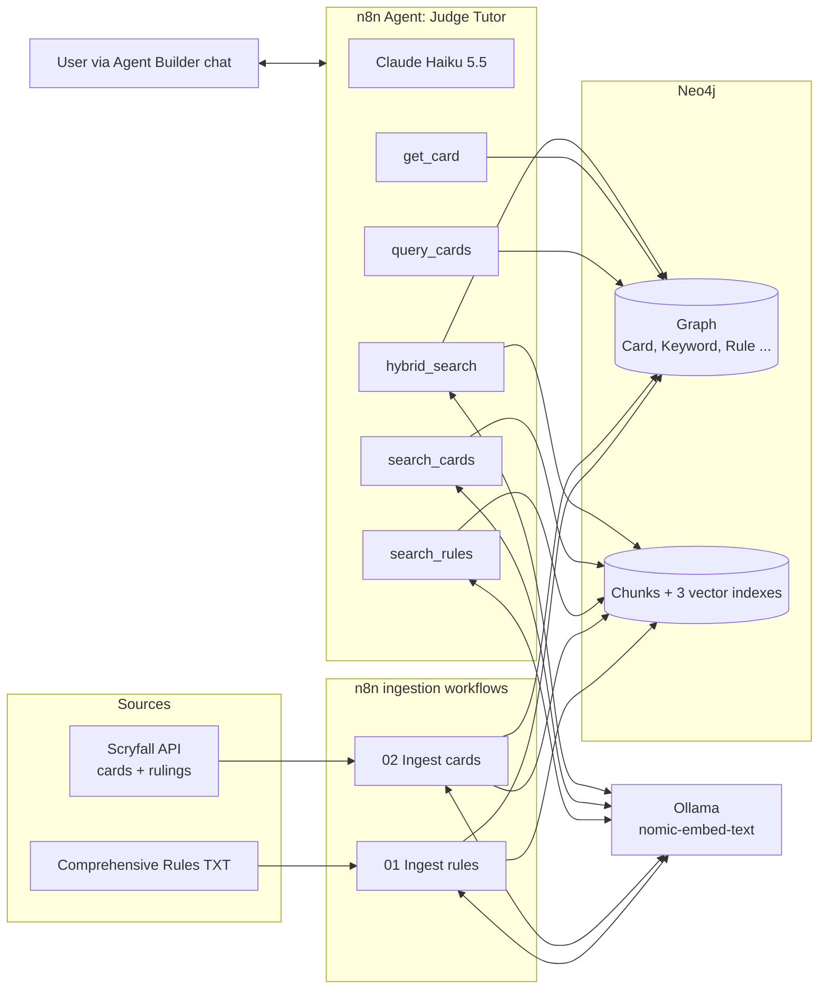

# Judge Tutor: Magic: The Gathering Vector + Graph RAG

**Case:** Magic: The Gathering has tens of thousands of cards and a rulebook of more than 250 pages. New players struggle with rules interactions ("what happens when trample meets deathtouch?") and with finding cards for a deck. This project stores the official Comprehensive Rules, the cards of one set and their official rulings in a single Neo4j database, both as vector-searchable text chunks and as a knowledge graph. An n8n agent sits on top.

**Agent role:** "Judge Tutor", a rules judge and deckbuilding tutor that only answers from retrieved data and cites rule numbers and card sources. Instructions and guardrails: [agent/system_prompt.md](agent/system_prompt.md).

## Stack

| Component | Version / model | Runs |
|---|---|---|
| n8n | 2.45.7, self-hosted in Docker, Agents module enabled | local |
| Neo4j | 2026.09.0 (Cypher 25), Neo4j Desktop 2 | local |
| Embeddings | `nomic-embed-text` (768 dims) via Ollama, on GPU | local |
| Agent model | Claude Haiku 5.5 (`claude-haiku-5-5`) via Anthropic | cloud API |

## Architecture

**Ingestion.** Both ingestion workflows follow the same steps: fetch the source, chunk or normalise it, upsert graph nodes with `MERGE`, compare content hashes with what is already in Neo4j, embed only new or changed chunks with Ollama (32 texts per request, one request at a time), upsert the chunks with their embedding, and link keywords to the rule that defines them.

**Retrieval.** The agent has five workflow tools. Vector tools embed the question with the same model and query a Neo4j vector index; graph tools run parameterised Cypher. Vector chunks hang off graph nodes (`(Rule)-[:HAS_CHUNK]->(RuleChunk)`, `(Card)-[:HAS_CHUNK]->(CardChunk)`), which is what lets `hybrid_search` go from a vector hit to graph facts in a single query. Every tool returns its source (rule number or Scryfall link) with the data.

## Where to find things

| Requirement | Location |
|---|---|
| Workflow JSON | [workflows/](workflows/) |
| Workflow screenshots | [screenshots/](screenshots/) |
| Agent model, instructions, guardrails | [agent/system_prompt.md](agent/system_prompt.md) |
| Tool descriptions (what, input, when) | [agent/tools.md](agent/tools.md) |
| Agent tool connections (screenshot) | [screenshots/agent_tools.png](screenshots/agent_tools.png) |
| Three example questions with assessment | [agent/example_questions.md](agent/example_questions.md) |
| Prompts and changes during development | [agent/development_notes.md](agent/development_notes.md) |
| AI-suggested schema and normalisation | [prompts/01_schema_suggestion.md](prompts/01_schema_suggestion.md) |
| AI-generated Cypher prompt | [prompts/02_cypher_generation.md](prompts/02_cypher_generation.md) |
| Data sources, sample, node/relationship types | [data/README.md](data/README.md), [data/sample/](data/sample/) |
| Neo4j constraints, indexes, normalisation | [neo4j/](neo4j/) |
| Cypher used by the workflows | [src/cypher/](src/cypher/) |
| Code node scripts | [src/code/](src/code/) |
| Docker setup for n8n | [docker-compose.yml](docker-compose.yml) |

### Workflows

| File | Purpose |
|---|---|
| `01_ingest_rules.json` | Data ingestion: Comprehensive Rules → Rule graph + RuleChunks |
| `02_ingest_cards.json` | Data ingestion: Scryfall cards + rulings → Card graph + CardChunks/RulingChunks |
| `10_tool_search_rules.json` | Vector retrieval over rules and rulings |
| `11_tool_search_cards.json` | Vector retrieval over cards |
| `12_tool_query_cards.json` | Graph retrieval: filter and count cards |
| `13_tool_get_card.json` | Graph retrieval: one card and its neighbourhood |
| `14_tool_hybrid_search.json` | Hybrid: vector hits expanded through the graph in one query |

## Data in this submission

| | Count |
|---|---|
| Comprehensive Rules | version effective June 19, 2026: 1,169 rules + 146 sections, 1,203 rule chunks |
| Cards | Foundations (`fdn`): 517 unique cards, 316 of them with rulings |
| Chunks with embeddings | 2,036 (1,203 rule + 517 card + 316 ruling) |
| Keywords | 39, of which 32 linked to a rule (29 automatically, 3 by manual normalisation) |

Details on node types, relationships, properties and chunking: [data/README.md](data/README.md).

## Setup (recreate everything)

1. **Ollama:** `ollama pull nomic-embed-text`.
2. **Neo4j:** create a local instance (2026.x or 5.13+). In the query editor run `neo4j/01_setup.cypher`, then `neo4j/02_seed.cypher`.
3. **n8n:** start with [docker-compose.yml](docker-compose.yml) (`docker compose up -d`). The line `N8N_ENABLED_MODULES=agents` is required: without it the Agents tab does not appear on self-hosted n8n.
4. **Import** every file in `workflows/`. Create an *HTTP Basic Auth* credential with the Neo4j user and password and select it in every node named `Neo4j: ...`.
5. **Config:** open the `Config` node in each workflow and check the URLs. Use `host.docker.internal` when n8n runs in Docker and Neo4j/Ollama run on the host. In workflow 01, paste the current TXT link from the [rules page](https://magic.wizards.com/en/rules) into `cr_url` (replace spaces with `%20`).
6. **Ingest:** run `01_ingest_rules`, then `02_ingest_cards`. Re-running is safe: nodes use `MERGE`, unchanged chunks are skipped.
7. **Normalise:** run `neo4j/03_manual_keyword_links.cypher`.
8. **Check:** run the queries in `neo4j/inspect.cypher`.
9. **Publish** the five tool workflows (Agent Builder can only call published workflows).
10. **Agent:** Personal → Agents → Create Agent. Model: Anthropic → Claude Haiku 5.5 (needs a Claude Console API key). Paste the instructions from `agent/system_prompt.md`, add the five tool workflows under *Add workflow* with the descriptions from `agent/tools.md`.

Adding a new set later: change `set_codes` in the Config node of workflow 02 (e.g. `'fdn dsk'`) and run it again. Only the new cards are embedded.

## Model choice

The plan was to run everything locally, including the agent model (`qwen2.5:7b` in Ollama). That did not work with Agent Builder:

1. Agent Builder has no Ollama provider. Ollama was connected through the OpenAI provider using Ollama's OpenAI-compatible endpoint (`/v1`).
2. With Ollama's default context window, the instructions and tool definitions were cut off, so the model answered from memory without tools. Raising `OLLAMA_CONTEXT_LENGTH` to 16384 fixed that.
3. The next request then failed with `unknown input item type: "item_reference"`. Agent Builder uses OpenAI's Responses API, and Ollama's compatibility layer does not support that item type, so every tool call breaks.

The agent model was therefore switched to Claude Haiku 5.5. Embeddings, Neo4j and all retrieval still run locally. API usage is prepaid with auto-reload off, so costs are capped. Full log: [agent/development_notes.md](agent/development_notes.md).

## Problems solved during the build

| Problem | Cause | Fix |
|---|---|---|
| `ECONNREFUSED` from Ollama at random items | n8n's HTTP node sends all items at once by default (1,203 parallel requests); Ollama queued them and Docker's proxy started refusing connections | Batch 32 texts per request and set the HTTP node's batching to 1 request at a time (1,203 → 38 requests) |
| `ECONNRESET` from Scryfall | Short network drop during 517 rulings requests | Retry on fail (3 tries, 2 s) |
| Agents tab missing | Agents module is opt-in on this self-hosted version | `N8N_ENABLED_MODULES=agents` in docker-compose |
| Cypher syntax errors | Neo4j 2026 defaults to Cypher 25 | `CALL () { ... }` scope syntax instead of `CALL { WITH ... }` |

## Limitations

- **One set only.** The card database is Foundations. Questions about other cards are answered with "not in my database" (see Q3), and the model sometimes leaks facts from its own training data anyway.
- **`query_cards` cannot search by name.** Partial name searches fall back to rules text and miss cards (Q3).
- **Ability words** (Landfall, Raid, Morbid, ...) have no rule of their own, so they have no `DEFINED_BY` link.
- **Vector search favours one topic.** A question mixing two mechanics returns chunks for the dominant one; mitigated with an instruction to search once per mechanic.
- **The agent's description of its own tool calls is not always accurate** (Q1). The execution log is the reliable record.
- **Not fully local.** The agent model runs on the Claude API because of the Ollama/Responses API incompatibility.
